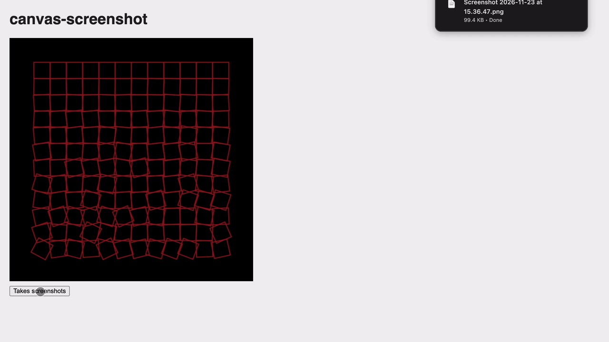

# canvas-screenshot

[](https://www.npmjs.com/package/canvas-screenshot)
[](https://www.npmjs.com/package/canvas-screenshot)
[](https://bundlephobia.com/package/canvas-screenshot)
[](https://github.com/dmnsgn/canvas-screenshot/blob/main/package.json)
[](https://github.com/microsoft/TypeScript)
[](https://conventionalcommits.org)
[](https://github.com/prettier/prettier)
[](https://github.com/eslint/eslint)
[](https://github.com/dmnsgn/canvas-screenshot/blob/main/LICENSE.md)

A one trick pony package to download an image from a canvas.

[](https://paypal.me/dmnsgn)
[](https://commerce.coinbase.com/checkout/56cbdf28-e323-48d8-9c98-7019e72c97f3)
[](https://twitter.com/dmnsgn)



## Installation

```bash
npm install canvas-screenshot
```

## Usage

```js
import canvasScreenshot from "canvas-screenshot";
import canvasContext from "canvas-context";

// Create
const { context, canvas } = canvasContext("2d", {
  width: 100,
  height: 100,
});

// Draw
context.fillStyle = "salmon";
context.fillRect(40, 40, 20, 20);

// Export
const button = document.createElement("button");
button.addEventListener("click", () => {
  canvasScreenshot(canvas);
});
```

Encode an `OffscreenCanvas` (always async). Browsers that can't encode WebP fall back to PNG:

```js
const offscreenCanvas = new OffscreenCanvas(256, 256);
// ...draw
const blob = await canvasScreenshot(offscreenCanvas, {
  filename: "image.webp",
  download: false,
});
```

## API

<!-- api-start -->

## Modules

<dl>
<dt><a href="#module_canvasScreenshot">canvasScreenshot</a></dt>
<dd></dd>
</dl>

## Typedefs

<dl>
<dt><a href="#CanvasScreenshotOptions">CanvasScreenshotOptions</a> : <code>object</code></dt>
<dd><p>Options for canvas screenshot. All
  optional.</p>
</dd>
</dl>

<a name="module_canvasScreenshot"></a>

## canvasScreenshot

<a name="exp_module_canvasScreenshot--canvasScreenshot"></a>

### canvasScreenshot(canvas, [options]) ⇒ <code>string</code> \| <code>Promise.&lt;Blob&gt;</code> ⏏

Take a screenshot. Setting `options.useBlob` to `true` will consequently make
the module async and return the latter. An `OffscreenCanvas` has no data URL:
it always returns a `Promise` resolving with a `Blob`.

**Kind**: Exported function
**Returns**: <code>string</code> \| <code>Promise.&lt;Blob&gt;</code> - A `DOMString` or a `Promise` resolving with
a `Blob`.

Type is inferred from the filename extension:

- "png" for `"image/png"` (default)
- "jpg/jpeg" for `"image/jpeg"`
- "webp for" `"image/webp"`

| Param     | Type                                                             | Default         | Description        |
| --------- | ---------------------------------------------------------------- | --------------- | ------------------ |
| canvas    | <code>HTMLCanvasElement</code> \| <code>OffscreenCanvas</code>   |                 | The canvas element |
| [options] | [<code>CanvasScreenshotOptions</code>](#CanvasScreenshotOptions) | <code>{}</code> |                    |

<a name="CanvasScreenshotOptions"></a>

## CanvasScreenshotOptions : <code>object</code>

Options for canvas screenshot. All
optional.

**Kind**: global typedef
**Properties**

| Name       | Type                 | Default                                                        | Description                                                                                                             |
| ---------- | -------------------- | -------------------------------------------------------------- | ----------------------------------------------------------------------------------------------------------------------- |
| [filename] | <code>string</code>  | <code>&quot;Screenshot YYYY-MM-DD at HH.MM.SS.png&quot;</code> | File name. The default uses UTC time and an extension matching `type`.                                                  |
| [type]     | <code>string</code>  |                                                                | MIME type. Inferred from the filename extension by default. Unsupported types are encoded as PNG, as per the HTML spec. |
| [quality]  | <code>number</code>  | <code>1</code>                                                 | Quality between 0 and 1.                                                                                                |
| [useBlob]  | <code>boolean</code> |                                                                | Use `canvas.toBlob` or `canvas.convertToBlob`. Always true for an `OffscreenCanvas`.                                    |
| [download] | <code>boolean</code> |                                                                | Automatically download the screenshot. Defaults to `true` when a DOM is available (`false` in workers).                 |

<!-- api-end -->

## License

MIT. See [license file](https://github.com/dmnsgn/canvas-screenshot/blob/main/LICENSE.md).
